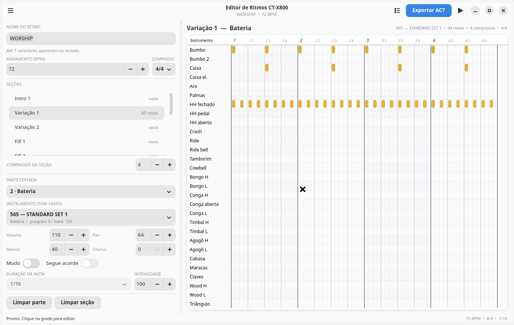
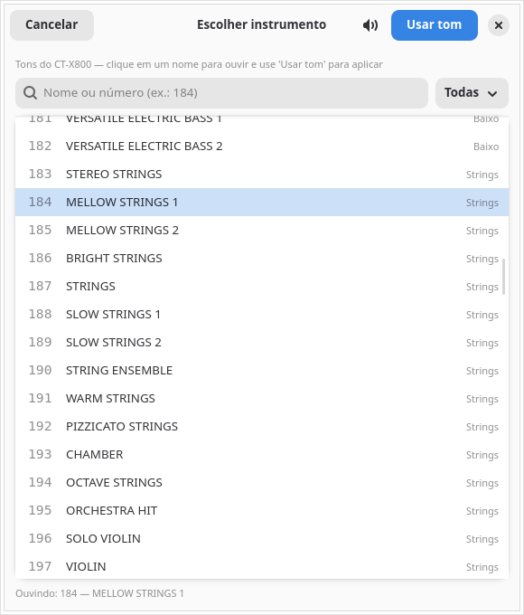

# Editor de Ritmos CT-X800

Editor gráfico para criar e editar ritmos do **Casio CT-X800** no PC, ouvir uma
prévia com som de instrumentos e exportar o arquivo **`.AC7`** para a pasta
`MUSICDAT` de um pendrive FAT32.



## Recursos

- **12 seções**: Intro 1/2, Variações 1–4, Fills 1–4 e Endings 1/2.
- **8 partes** editáveis, com nomes de arranjo:
  1 Percussão, 2 Bateria, 3 Baixo, 4 Piano, 5 Strings, 6 E. Piano,
  7 Violão e 8 Pad/Coro.
- **600 tons do CT-X800** com busca por nome/número e filtro por categoria.
  As partes 1 e 2 usam os **36 kits de bateria** do teclado.
- **Misturador** das 8 partes: instrumento, volume, pan, reverb, chorus e mute.
- **Segue acorde** por parte (chord sync do AC7).
- **Compassos**: 4/4, 3/4, 2/4 e 6/8; de 1 a 8 compassos por seção.
- Grade de bateria com 29 notas (bumbo, caixa, chimbais, pratos, percussão).
- Piano roll para as partes melódicas, com duração de 1/16 até 1 compasso.
- Prévia da seção em loop com **FluidSynth + GStreamer**, com playhead.
- Salvar/abrir projeto em JSON (versão 2; abre também projetos da versão 1).
- Exportar **AC7** com 12 elementos, 8 partes e 96 entradas de mixer.
- Tema claro/escuro conforme o sistema.
- Interface em português.

## Requisitos

Testado no Debian 13 (Lig OS), com GTK 4, Libadwaita, GStreamer, FluidSynth e
Python 3.

```bash
sudo apt install python3-gi gir1.2-gtk-4.0 gir1.2-adw-1 \
    gir1.2-gstreamer-1.0 gir1.2-gst-plugins-base-1.0 \
    fluidsynth fluid-soundfont-gm python3-mido
```

Se preferir instalar o `mido` pelo pip:

```bash
python3 -m pip install --user -r requirements.txt
```

## Instalar e abrir

```bash
git clone https://github.com/Denilsonnofficial/ctx800-editor.git
cd ctx800-editor
./run.sh
```

Também funciona:

```bash
./rodar.sh
# ou
python3 main.py
```

### Atalho no menu de aplicativos (opcional)

```bash
mkdir -p ~/.local/bin ~/.local/share/applications
ln -sf "$PWD/run.sh" ~/.local/bin/ctx800-editor
cp packaging/br.com.ctx800.Editor.desktop \
    ~/.local/share/applications/
update-desktop-database ~/.local/share/applications 2>/dev/null || true
```

Depois é só procurar por **Editor de Ritmos CT-X800** no menu, ou rodar
`ctx800-editor` no terminal.

## Como usar

1. Abra o programa. O projeto de exemplo **WORSHIP** já vem na Variação 1.
2. Ajuste **nome**, **andamento** e **compasso** na barra lateral.
3. Escolha uma seção na lista (role para ver as 12).
4. Escolha a **parte editada** (1–8).
5. Clique em **instrumento** para escolher um dos 600 tons do CT-X800.
   Use a busca ou o filtro de categoria.
6. Monte as notas na grade:
   - clique esquerdo em uma célula vazia adiciona;
   - clique esquerdo em uma nota remove;
   - clique direito remove;
   - para notas melódicas, escolha a duração antes de adicionar.
7. Aperte **Espaço** para ouvir a seção em loop.
8. Use **Misturador** (ícone de lista no topo ou Ctrl+M) para balançar as 8
   partes.
9. **Exportar AC7** e copie o arquivo para o pendrive.

### Atalhos

| Ação | Atalho |
|---|---|
| Tocar/parar a seção | Espaço |
| Novo projeto | Ctrl+N |
| Abrir projeto | Ctrl+O |
| Salvar | Ctrl+S |
| Salvar como | Ctrl+Shift+S |
| Exportar AC7 | Ctrl+E |
| Misturador | Ctrl+M |

## Instrumentos e prévia

Cada parte guarda um **tom Casio** (número, program change e bank select MSB).
O AC7 exportado usa exatamente esses valores; no teclado, o timbre é o real.

No seletor dá para buscar pelo nome ou número e filtrar por categoria.
**Clique em um nome para ouvir uma frase curta** com o timbre; o botão de
alto-falante repete o tom selecionado e **Usar tom** aplica o instrumento.



A prévia no PC é renderizada com um **SoundFont GM** e é uma **aproximação**:
- o programa GM equivalente é usado para cada tom;
- as duas partes de bateria são misturadas em um único kit GM na prévia;
- o timbre final só é fiel no CT-X800.

Se o SoundFont não estiver em `/usr/share/sounds/sf2/default-GM.sf2`, o editor
tenta `FluidR3_GM.sf2` e `TimGM6mb.sf2`.

## AC7 exportado

O arquivo sempre tem:

- **12 elementos** (Intro 1/2, Variações 1–4, Fills 1–4, Endings 1/2);
- **8 partes** e **96 entradas de mixer** (12 × 8);
- nome de exibição de até **7 caracteres** (acentos são removidos).

As partes mudas saem com volume 0 e sem notas. Se uma seção inteira estiver
vazia ou muda, o editor grava um MIDI só de regência para preservar o número de
compassos e o compasso configurado.

O tamanho máximo do AC7 no CT-X800 é de aproximadamente **64 KB**; o editor
valida antes de gravar.

### Tons padrão

| Parte | Conteúdo | Tom padrão |
|---|---|---|
| 1 | Percussão | 588 LATIN SET 1 |
| 2 | Bateria | 565 STANDARD SET 1 |
| 3 | Baixo | 139 FINGERED BASS 1 |
| 4 | Piano | 002 GRAND PIANO |
| 5 | Strings | 184 MELLOW STRINGS 1 |
| 6 | E. Piano | 025 ELEC.PIANO 2 |
| 7 | Violão | 090 NYLON STR.GUITAR 1 |
| 8 | Pad/Coro | 318 SYNTH-STRINGS 1 |

Todos podem ser trocados no editor.

## Instalar no teclado

1. Pendrive em **FAT32**, com a pasta **`MUSICDAT`** na raiz.
2. Copie o `.AC7` para dentro de `MUSICDAT`.
3. No CT-X800: `FUNCTION` → `Media` → `Load` → `Rhythm`.
4. Selecione o arquivo.
5. Escolha uma posição de usuário (**196–205**) e confirme **Replace?** se
   precisar.

O editor **não copia automaticamente** para o pendrive: assim você decide
quando substituir a versão que está no teclado.

## Onde ficam os arquivos

```
~/ctx800/ritmos/              projetos .ctx800.json (padrão)
./saidas/                     AC7 exportados (pasta do programa)
~/.cache/ctx800-editor/       WAVs de prévia em cache
```

O projeto é um JSON; pode ser copiado e versionado como qualquer arquivo.

## Limitações desta versão

- A prévia usa GM, não os timbres exatos do teclado.
- Ainda não importa AC7, MIDI ou styles Yamaha `.STY`.
- A duração e a intensidade valem para as notas **novas**; ainda não há edição
  de uma nota individual já criada.
- Não há undo/redo.
- Alguns dos 12 elementos podem não ser acessíveis em todos os modelos CT-X;
  os principais são Intro 1, Variações 1/2, Fills 1/2 e Ending 1.
- Não copia automaticamente para o pendrive.

## Testes

```bash
python3 -m unittest discover -s tests -v
```

Os testes cobrem a lista de 600 tons, o modelo, compatibilidade com projetos da
versão 1, clipping de compasso/seção e a exportação AC7 (12 elementos, 96
mixers, mute, 4/4 e 3/4).

## Créditos e licença

- **ac7maker** — https://github.com/michgz/ac7maker (GPL-3.0), incluído em
  `vendor/ac7maker/`.
- Lista de tons baseada no apêndice oficial do manual do CT-X800.
- GTK 4, Libadwaita, GStreamer, FluidSynth, mido.

Este projeto é distribuído sob a **GPL-3.0**; veja `LICENSE`.
